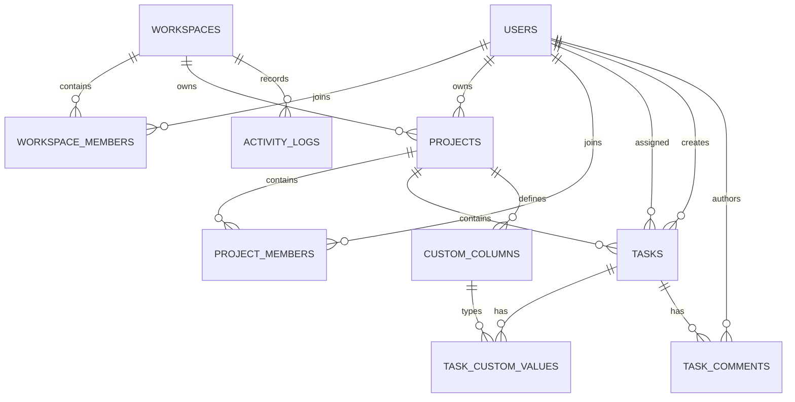

# Nimbus normalized data model

## Core keys

- `workspace_members`: primary key `(workspace_id, user_id)`.
- `project_members`: primary key `(project_id, user_id)`.
- `task_custom_values`: primary key `(task_id, column_id)`.
- All child foreign keys use `ON DELETE RESTRICT` or `CASCADE` deliberately.
- Archive fields preserve lifecycle history; permanent deletes are exceptional.

## Task audit columns

`tasks` stores `project_id`, `assignee_id`, `created_by`, `updated_by`,
`archived_by`, `created_at`, `updated_at`, and `archived_at`. Display names and
role labels are joined at read time.
